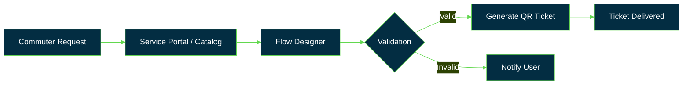

**Building workflows on the Now Platform**
Final-year ECE undergrad @ GVPCE(A) with an electronics mindset: systems, signals, and clean automation.

---

## 🧭 At a Glance

| | |
|---|---|
| **Focus** | ServiceNow development and workflow automation |
| **Education** | B.Tech ECE, Gayatri Vidya Parishad College of Engineering (A), Visakhapatnam, 2027 |
| **Currently** | Building on a ServiceNow Personal Developer Instance (PDI) |
| **Open to** | Junior ServiceNow Developer roles |

---

## 🔄 How I Think About Workflows

---

## 🚀 Projects

| Project | What it solves | Built with | Status |
|---|---|---|---|
| **🚇 Digital Metro Ticketing** | Book metro tickets digitally and get a QR-code ticket | `ServiceNow` `Flow Designer` `Scripting` | 🟡 In progress |
| **🔌 Smart EV Charging Platform** | EV charging management, built for the FLOW MASTERS hackathon | `ServiceNow` `REST API` `Gemini` | 🟡 In progress |

---

## 🧰 Toolkit

| Layer | Tools |
|---|---|
| **Platform** |   |
| **Integration** |   |
| **Scripting** |  |
| **Version control** |   |

---

## 🗺️ Roadmap

- [x] ServiceNow PDI set up
- [ ] Push Metro Ticketing project to GitHub with README and screenshots
- [ ] Submit the FLOW MASTERS hackathon project
- [ ] Connect PDI to GitHub using Source Control

---

## 🤝 Activities

- Former Director of Photography, Rotaract Club 📸

